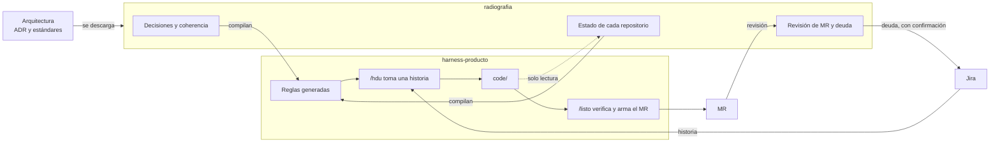

# radiografia

Herramienta para gobernar productos de software desde [Cursor](https://cursor.com). Mira el código tal
como está hoy, lo compara con las reglas decididas y deja por escrito, con evidencia, qué se cumple y
qué no.

Las reglas tienen un orden de autoridad. Cuando dos hablan de lo mismo, manda la de arriba:

1. ADR de arquitectura
2. Estándares de arquitectura
3. Decisiones del equipo (ADR-EQ): aplican a todos los productos
4. Decisiones del producto (ADR-\<SIGLA\>): aplican a un producto y no contradicen las del equipo
5. Sonar

> Un **ADR** es un documento corto que registra una decisión técnica y la regla que deja. Un
> **hallazgo** es un incumplimiento concreto, con archivo y línea. Un **MR** es la propuesta de cambio
> que se revisa antes de integrarla. Más términos en [Conceptos](docs/02-conceptos.md).

## Dos repositorios

| | radiografia | harness-\<producto\> |
|---|---|---|
| Para qué | gobernar: decisiones, estado del código, revisión de MR y deuda | desarrollar las historias de Jira de un producto |
| Cuántos | uno | uno por producto, generado por radiografia |
| Repositorios del producto | copias de solo lectura | se desarrollan en `code/` |
| Comandos | `/estado` `/actualizar` `/producto` `/revisar` `/triar` `/crear` | `/hdu` `/listo` |



radiografia no modifica el código que revisa, no inventa (toda afirmación lleva evidencia) y no escribe
nada fuera sin vista previa y confirmación. Detalle en [Cómo gobierna](docs/09-harness.md).

## Empezar

Requisitos: Python 3.11, `git`, `make`, Cursor y `gitleaks`; acceso de lectura a los repositorios y un
token de Sonar.

```sh
cp .env.example .env      # completar Sonar y, si se usan, Jira y la plataforma git
make venv
make doctor
```

Abrir la carpeta en Cursor y escribir `/estado`: indica qué hacer a continuación.

## Comandos

| Comando | Cuándo | Qué hace |
|---|---|---|
| `/estado [semanal]` | al empezar | qué hay pendiente y qué sigue; con `semanal`, qué cambió en la semana |
| `/actualizar [fuentes]` | cada semana | descarga arquitectura, verifica la coherencia de las decisiones y actualiza los harness |
| `/producto <nombre> [harness]` | al recibir o iniciar un producto | registra el producto, sus repositorios y sus terceros; con `harness`, crea su harness |
| `/revisar <producto> [repo]` | al tomar el control y cuando el código cambia | revisa un repositorio y deja su estado, hallazgos y veredicto. Un chat por repositorio |
| `/revisar mr` | cada día | bandeja de MR abiertos: revisa uno o la coherencia de un ADR propuesto |
| `/triar <producto>` | después de revisar | decide qué hacer con cada hallazgo |
| `/crear <producto>` | cuando hace falta | un ADR, una excepción, o una Tarea, un Spike, un Error o un Hotfix para Jira |

**Primera vez:** `/actualizar fuentes` → `/actualizar` → `/producto` → `/revisar` → `/triar` →
`/producto <nombre> harness`. **Después:** `/revisar mr` cada día y `/estado semanal` cada semana.

## Resultados

| Qué | Dónde |
|---|---|
| Todos los productos | `productos/INDICE.md` |
| Un producto y sus repositorios | `productos/<producto>/INDICE.md` y `as-is/` |
| Decisiones del equipo y su coherencia | `equipo/INDICE.md` y `equipo/COHERENCIA.md` |
| Decisiones de un producto | `decisiones/` de su harness |

## Documentación

Guía paso a paso en [docs/](docs/README.md). Contrato de trabajo para Cursor en [AGENTS.md](AGENTS.md).
Decisiones del equipo en [equipo/](equipo/README.md). README de cada harness en
[herramientas/plantilla_harness/](herramientas/plantilla_harness/README.md).
