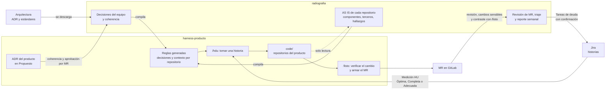

# radiografia

Herramienta para gobernar productos de software. Mira el código tal como está hoy, lo compara con las
reglas que la organización decidió y deja por escrito, con evidencia, qué se cumple y qué no. Se usa
desde [Cursor](https://cursor.com) con comandos que empiezan por `/`.

Hace tres cosas:

1. **Revisa** cada repositorio de un producto y registra hallazgos con evidencia (`archivo:línea` y la
   cita de la regla incumplida).
2. **Gobierna las decisiones**: mantiene las del equipo, verifica que ninguna contradiga a una de mayor
   autoridad y aprueba las de cada producto.
3. **Crea y mantiene el harness de cada producto** (`harness-<producto>`): el repositorio donde se
   desarrollan las historias de ese producto con las mismas reglas.

## Conceptos en una línea

| Término | Qué es |
|---|---|
| **ADR** | Registro de una decisión de arquitectura: documento corto que dice qué se decidió, por qué y qué regla deja |
| **ADR de arquitectura y estándares** | Los publica el área de arquitectura en sus repositorios. Se descargan tal cual y no se editan |
| **ADR-EQ** | Decisiones del equipo. Aplican a todos los productos (por ejemplo: toda llamada externa tiene timeout) |
| **ADR-\<SIGLA\>** | Decisiones de un producto; la sigla identifica al producto (`ADR-MF-001` para el motor de fraude). No pueden relajar ni contradecir las del equipo |
| **Excepción** | ADR de producto que permite apartarse de una regla por un tiempo, con fecha de vencimiento y aprobación |
| **Criterio** | Cada regla verificable de un ADR, con un identificador fijo (`EQ-002.1`) y una severidad |
| **AS IS** | Cómo está el código hoy, descrito con evidencia; no cómo debería estar |
| **Hallazgo** | Un incumplimiento concreto: qué regla, en qué archivo y línea, con qué severidad |
| **Coherencia** | Comprobación de que una decisión del equipo o del producto no contradiga a una de mayor autoridad |
| **Triaje** | Decidir qué se hace con cada hallazgo: resolver, conversar, aceptar como deuda o marcar falso positivo |
| **Deuda** | Trabajo pendiente que se acepta a sabiendas, con vencimiento; se lleva a Jira como Tarea |
| **Veredicto** | PASA o NO PASA por repositorio: NO PASA si queda abierto algún hallazgo bloqueante o alto |
| **MR** | Merge request (pull request en GitHub): la propuesta de cambio que se revisa antes de integrarla |
| **Sonar** | SonarQube o SonarCloud: análisis automático de calidad del código |
| **Harness** | Repositorio de trabajo de un producto, generado por radiografia, con sus repositorios en `code/` y las reglas compiladas |
| **Medición HU** | Campo de Jira con la calidad de una historia de usuario (HU). El harness solo toma historias Óptimas, Completas o Adecuadas |

## El orden de autoridad

Cuando dos reglas hablan de lo mismo, manda la de mayor autoridad. Un problema se reporta una sola vez,
en el nivel más alto donde aparece.

| Nivel | Fuente | Quién la escribe |
|---|---|---|
| 1 | ADR de arquitectura | arquitectura |
| 2 | Estándares de arquitectura | arquitectura |
| 3 | Decisiones del equipo (ADR-EQ) | el equipo, desde radiografia |
| 4 | Decisiones del producto (ADR-\<SIGLA\>) | cada producto, en su harness; se aprueban por MR tras verificar su coherencia |
| 5 | Sonar | el análisis automático |

Una decisión en estado `Propuesto` se evalúa pero no cambia el veredicto: sirve para calibrarla antes
de aprobarla.

## radiografia y el harness de cada producto

| | radiografia | harness-\<producto\> |
|---|---|---|
| Para qué | gobernar: decisiones, AS IS, coherencia, triaje, revisión de MR y deuda | desarrollar las historias de Jira del producto |
| Cuántos | uno para todo el portafolio | uno por producto |
| Repositorios del producto | copias de solo lectura | se desarrollan en `code/` |
| Decisiones | crea las del equipo, verifica la coherencia de todas y aprueba las del producto | recibe las reglas compiladas; propone las del producto |
| Comandos | `/estado`, `/actualizar`, `/producto`, `/revisar`, `/triar`, `/crear` | `/hdu` y `/listo` |

### Cómo se conectan



Se lee de izquierda a derecha: arquitectura y Jira entran por la izquierda; radiografia compila las
reglas y el conocimiento de cada repositorio hacia el harness; en el harness se toma una historia, se
desarrolla y se verifica antes del MR; radiografia revisa el MR y lleva la deuda a Jira. La flecha
punteada recuerda que radiografia solo lee los repositorios del producto.

| radiografia gobierna… | Cómo |
|---|---|
| Las reglas del código | Compila en cada harness la arquitectura vigente, los ADR del equipo y del producto y las excepciones aprobadas. Se regeneran en cada `/actualizar`; el harness no las edita |
| El conocimiento de cada repositorio | Lo descubre en la revisión AS IS y lo entrega compilado: propósito, componentes (bases, colas, integraciones), terceros y hallazgos abiertos |
| Las decisiones del producto | Viven en el harness y nacen en `Propuesto`. radiografia verifica su coherencia antes de que se aprueben por MR. Las excepciones se crean solo desde radiografia |
| La calidad de las historias | Propone la Medición HU; el harness solo toma historias Óptimas, Completas o Adecuadas |
| El resultado de cada cambio | Revisa cada MR por su cuenta: vuelve a correr las verificaciones, detecta cambios sensibles (pruebas deshabilitadas, controles apagados) y contrasta lo que declaró `/listo`. La deuda declarada se lleva a Jira con confirmación |
| La estructura del harness | Lo crea desde su plantilla y le agrega lo nuevo sin pisar lo que el harness ya ajustó |
| Lo que se puede hacer | Guardias en Cursor: en el harness no hay push a `main` ni `--force`; radiografia no escribe en los repositorios del producto |

### Garantías

- **No modifica el código que revisa.** Los repositorios del producto son copias de solo lectura.
- **No inventa.** Toda afirmación lleva evidencia que los scripts validan; lo que no se pudo verificar
  queda `NO DETERMINADO`.
- **Nada sale sin confirmación.** Lo único que escribe fuera es el comentario de la revisión en un MR y
  las Tareas, Spikes, Errores y Hotfix en Jira, siempre con vista previa. El push del harness es manual.
- **Nada se ejecuta solo.** Sin tareas programadas: cada comando lo lanza una persona.

## Empezar

Requisitos: macOS o Linux con Python 3.11, `git`, `make` y Cursor; `gitleaks` para buscar secretos y
`pdftotext` para leer documentación en PDF; acceso de lectura por git a los repositorios; un token de
Sonar y, si se usan, de Jira y de la plataforma git.

```sh
cp .env.example .env      # completar Sonar y, si se usan, Jira y la plataforma git
make venv                 # entorno de Python con las dependencias
make doctor               # verifica herramientas y configuración; no muestra valores de tokens
```

Después, abrir la carpeta en Cursor y escribir `/estado`: indica qué hacer a continuación. Detalle en
[Instalación](docs/01-instalacion.md).

## Comandos

| Comando | Cuándo usarlo | Qué hace |
|---|---|---|
| `/estado [semanal]` | al empezar cualquier sesión | muestra qué hay pendiente y qué comando sigue; con `semanal`, qué cambió desde el reporte anterior |
| `/actualizar [fuentes]` | antes de revisar, y cada semana | descarga arquitectura, verifica la coherencia de las decisiones y mantiene los harness; con `fuentes`, registra los repositorios de arquitectura |
| `/producto <nombre> [harness]` | al recibir o iniciar un producto | registra el producto, sus repositorios y sus terceros (producto comprado e integraciones); con `harness`, crea su harness |
| `/revisar <producto> [repo]` | al tomar el control de un producto y cuando su código cambia | revisa un repositorio: parte automática, AS IS, componentes, comparación con lo decidido y veredicto. Un chat por repositorio |
| `/revisar mr` | una o dos veces al día | bandeja de MR abiertos; revisa uno o la coherencia de un ADR propuesto en un harness |
| `/triar <producto>` | después de cada revisión | decide qué hacer con cada hallazgo y muestra qué reglas generan falsos positivos |
| `/crear <producto>` | cuando hace falta una decisión o una historia | crea un ADR del producto, una excepción, o una Tarea, un Spike, un Error o un Hotfix para Jira |

En cada harness: `/hdu <CLAVE>` para tomar una historia y `/listo <CLAVE>` antes de abrir el MR. Ver el
[README del harness](herramientas/plantilla_harness/README.md).

### Flujo típico

| Momento | Pasos |
|---|---|
| **Primera vez** | `/actualizar fuentes` → `/actualizar` → `/producto <nombre>` → `/revisar <producto>` (un chat por repositorio) → `/triar` → `/producto <nombre> harness` |
| **Cada día** | `/revisar mr` para los MR abiertos |
| **Cada semana** | `/estado semanal` → `/actualizar` → `/triar` → `/crear <producto> tarea --deuda <CLAVE>` para la deuda que va a Jira |

## Dónde mirar los resultados

| Qué | Dónde |
|---|---|
| Todos los productos: origen, repositorios, línea base, harness, veredicto | `productos/INDICE.md` |
| Un producto: repositorios, decisiones, revisiones y triaje pendiente | `productos/<producto>/INDICE.md` |
| Un repositorio: AS IS, componentes, comparación con lo decidido y veredicto | `productos/<producto>/as-is/<repo>.md` |
| El producto completo: matriz repositorio × regla, componentes compartidos, C4 y brechas | `productos/<producto>/as-is/PRODUCTO.md` |
| Hallazgos para conversar con el equipo | `productos/<producto>/triaje/agenda-<fecha>.md` |
| Reporte semanal | `productos/<producto>/semanal/<AAAA-Wnn>.md` |
| Decisiones del equipo y su coherencia con arquitectura | `equipo/INDICE.md` y `equipo/COHERENCIA.md` |
| Decisiones de un producto | `decisiones/` de su harness |
| Documentos de arquitectura descargados, con su estado | `arquitectura/INDICE.md` |

Los archivos en MAYÚSCULAS los genera radiografia y no se editan a mano.

## Documentación

La guía paso a paso está en [docs/](docs/README.md):

1. [Instalación](docs/01-instalacion.md)
2. [Conceptos](docs/02-conceptos.md): orden de autoridad, evidencia, hallazgos y veredicto
3. [Arquitectura y coherencia](docs/03-arquitectura.md)
4. [Productos y terceros](docs/04-productos.md)
5. [Revisión de repositorios y MR](docs/05-revisar.md)
6. [Triaje](docs/06-triar.md)
7. [Crear ADR, Tareas, Spikes, Errores y Hotfix](docs/07-crear.md)
8. [Mantenimiento](docs/08-mantenimiento.md)
9. [Harness del producto](docs/09-harness.md)

El contrato de trabajo para Cursor está en [AGENTS.md](AGENTS.md) y las decisiones del equipo en
[equipo/](equipo/README.md).

## Estado

- **Disponible:** los seis comandos de radiografia, la bandeja y la revisión de MR, y el harness de
  producto con `/hdu` y `/listo`.
- **Próximo:** medición de las historias en radiografia, y pruebas de integración y de carga.
