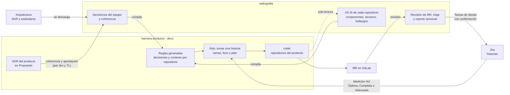

# radiografia

Herramienta para gobernar los productos del equipo. Revisa el estado real (AS IS) de los
repositorios de cada producto y lo compara con lo que se decidió, en este orden:

1. ADR de arquitectura
2. Estándares de arquitectura
3. Decisiones del equipo (ADR-EQ) y del producto
4. Sonar

Además crea y gobierna el **harness de cada producto** (`harness-<producto>`), el repositorio donde
los devs desarrollan el día a día.

## radiografia y harness-<producto>

| | radiografia | harness-<producto> |
|---|---|---|
| Para qué | gobernar: decisiones, AS IS, coherencia, triaje, revisión de MR, deuda | desarrollar las historias de Jira |
| Repositorios del producto | solo lectura | se desarrollan en `code/` |

## Cómo gobierna



| radiografia gobierna… | Cómo |
|---|---|
| Las reglas que siguen los devs | Compila en el harness la arquitectura vigente, los ADR del equipo y del producto y las excepciones aprobadas. El harness no las edita: se regeneran en cada `/actualizar` |
| El conocimiento de cada repositorio | Lo descubre en la revisión AS IS y lo entrega compilado: propósito, componentes, terceros y hallazgos abiertos |
| Las decisiones del producto | Viven en el harness y nacen en Propuesto. radiografia verifica su coherencia y solo se aprueban con un par dev y el TL. Las excepciones las crea solo el TL |
| La calidad de las historias | Propone la Medición HU; el harness solo toma historias Óptimas, Completas o Adecuadas |
| La estructura del harness | Lo crea desde su plantilla y le agrega lo nuevo sin pisar lo que el equipo ajustó |
| Lo que se puede hacer | Guardias en Cursor: el dev no hace push a `main` ni `--force`; radiografia no escribe en los repositorios del producto |

Cada hallazgo lleva su evidencia (`ruta:línea` y la cita del documento). Lo único que radiografia
escribe fuera es el comentario de la revisión en un MR y las Tareas, Spikes, Errores y Hotfix en Jira,
siempre con vista previa y confirmación. El push del harness es manual.

## Empezar

```sh
cp .env.example .env      # completar Sonar y, si se usan, Jira y la plataforma git
make venv
make doctor
```

Después, abrir la carpeta en Cursor y escribir `/estado`: indica qué hacer a continuación.

## Comandos

| Comando | Para qué |
|---|---|
| `/estado [semanal]` | ver qué hay pendiente y qué sigue; con `semanal`, qué cambió desde el reporte anterior |
| `/actualizar [fuentes]` | registrar y descargar arquitectura, verificar la coherencia de las decisiones y mantener los harness |
| `/producto <nombre> [harness]` | registrar un producto, sus repositorios y sus terceros; con `harness`, crear su harness |
| `/revisar <producto> [repo] [--rama <rama>]` | revisar un repositorio (un chat por repositorio), o solo lo que cambia un MR y comentarlo |
| `/triar <producto>` | decidir qué hacer con cada hallazgo |
| `/crear <producto>` | crear un ADR, una excepción, o una Tarea, un Spike, un Error o un Hotfix para Jira |

En el harness, el dev usa `/hdu <CLAVE>` para tomar una historia.

## Documentación

La guía paso a paso está en [docs/](docs/README.md):

1. [Instalación](docs/01-instalacion.md)
2. [Conceptos](docs/02-conceptos.md): orden de autoridad, evidencia, hallazgos y veredicto
3. [Arquitectura y coherencia](docs/03-arquitectura.md)
4. [Productos y terceros](docs/04-productos.md)
5. [Revisión de repositorios y ramas](docs/05-revisar.md)
6. [Triaje](docs/06-triar.md)
7. [Crear ADR, Tareas, Spikes, Errores y Hotfix](docs/07-crear.md)
8. [Mantenimiento](docs/08-mantenimiento.md)
9. [Harness del producto](docs/09-harness.md): el repositorio de trabajo de los devs

El contrato de trabajo para Cursor está en [AGENTS.md](AGENTS.md), y las decisiones del equipo en
[equipo/](equipo/README.md).

## Estado

- **Disponible:** los seis comandos de radiografia y el harness de producto con `/hdu`.
- **Próximo:** `/listo` en el harness, la deuda que deja cada historia y la bandeja de MR en radiografia.
- **Después:** medición de las historias en radiografia, y pruebas de integración y de carga.
