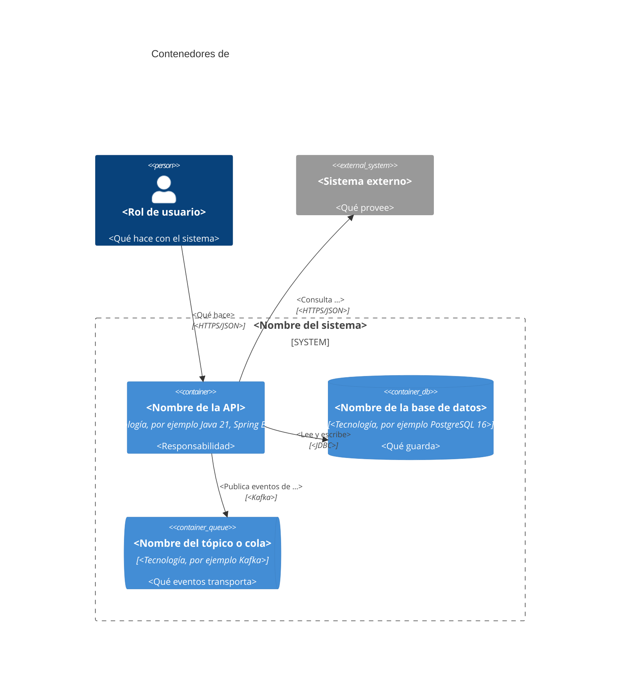

# Diagrama de contenedores: <nombre del sistema>

> Plantilla de ADR-EQ-006. Muestra las aplicaciones, bases de datos y colas que componen el
> sistema, con su tecnología y sus relaciones. Cada contenedor declara su tecnología y cada
> relación su protocolo.

## Contenedores

| Contenedor | Tecnología | Responsabilidad |
|---|---|---|
| <nombre> | <tecnología> | <responsabilidad> |
