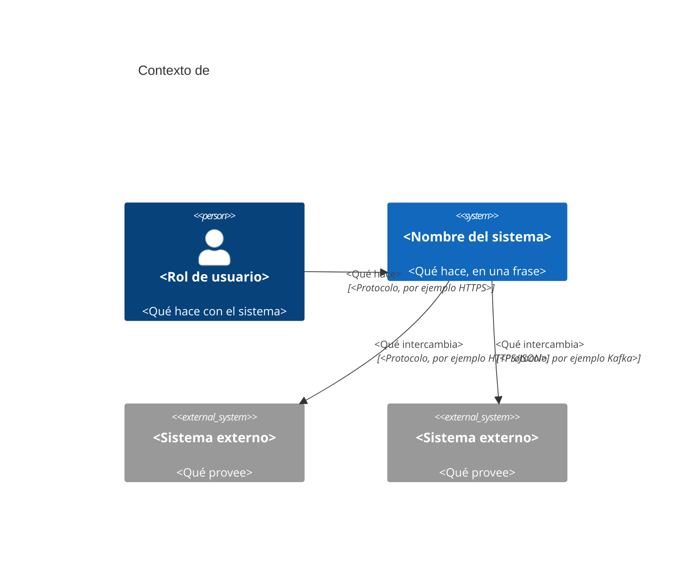

# Diagrama de contexto: <nombre del sistema>

> Plantilla de ADR-EQ-001. Muestra el sistema, quién lo usa y con qué sistemas externos se
> comunica. No muestra componentes internos: eso va en el diagrama de contenedores.

## Elementos

| Elemento | Tipo | Descripción |
|---|---|---|
| <nombre> | Persona / Sistema / Sistema externo | <descripción> |
