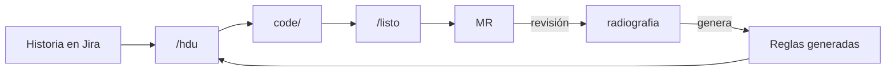

# harness-{{producto}}

Repositorio de trabajo para desarrollar **{{producto}}** con [Cursor](https://cursor.com). Reúne los
repositorios del producto en `code/` y las reglas que el código debe cumplir. Lo genera y lo revisa
**radiografia**.



1. **`/hdu <CLAVE>`** toma la historia de Jira: solo si su **Medición HU** es Óptima, Completa o
   Adecuada. Crea la rama en cada repositorio que toca, deja visibles solo esos repositorios y propone
   un plan con una prueba por criterio de aceptación.
2. **Desarrollar** en `code/<repo>/`, en esa rama, con el flujo normal de git.
3. **`/listo <CLAVE>`** antes del MR: verifica el cambio, registra la prueba de cada criterio y la deuda
   que deja la historia, y escribe la descripción del MR en `trabajo/<CLAVE>/mr-<repo>.md`.
4. **Push y MR** con esa descripción. El registro del final no se edita: lo usa la revisión.

## Empezar

Requisitos: Python 3.11, `git`, `make`, Cursor, `gitleaks` y un token de Jira con lectura.

```sh
cp .env.example .env    # JIRA_URL, JIRA_EMAIL y JIRA_TOKEN
make doctor
make code               # clona los repositorios en code/; ENLAZAR=~/repos reutiliza clones existentes
```

Abrir **esta carpeta** en Cursor, no la de un repositorio.

## Comandos

| Comando | Cuándo | Qué hace |
|---|---|---|
| `/hdu <CLAVE>` | al empezar una historia | Medición HU, ramas, foco, contexto y plan |
| `/listo <CLAVE>` | antes del MR | verificaciones, pruebas por criterio, deuda y descripción del MR |
| `make actualizar` | al empezar el día | trae la última versión del harness y de los repositorios |
| `make foco [REPOS=a,b]` | si hace falta | repositorios visibles en Cursor; sin `REPOS`, todos |

## Qué no se edita a mano

`.cursor/rules/generado/`, `.cursor/arquitectura/`, los `.json` de la raíz y los índices de `decisiones/` los genera radiografia
y llegan con `make actualizar`. El resto se cambia por MR a este repositorio.

`/hdu` y `/listo` traen solas la última versión de las reglas antes de empezar.

La guardia (`.cursor/hooks.json`) bloquea el push a `main`, el `--force` y aprobar o mergear MR desde
Cursor.

## Decisiones del producto

Viven en `decisiones/` (`ADR-{{sigla}}-NNN`) y nacen en `Propuesto` por MR, por ejemplo al cerrar un
Spike: `python3 herramientas/harness.py adr --titulo "<decisión>" --historia <CLAVE>`. radiografia
verifica su coherencia antes de aprobarlas. Ver [decisiones/README.md](decisiones/README.md).
