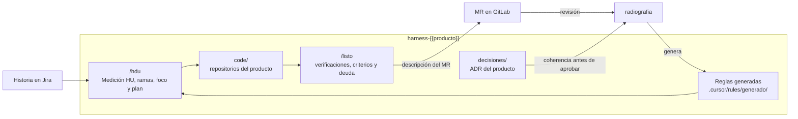

# harness-{{producto}}

Repositorio de trabajo para desarrollar **{{producto}}** con Cursor. Reúne los repositorios del producto
en `code/` y las decisiones que el código debe cumplir, para que cada historia de Jira se desarrolle con
el mismo contexto y llegue al MR verificada.

Lo gobierna **radiografia**: genera sus reglas, verifica la coherencia de sus decisiones y revisa sus MR.

## Cómo se trabaja



1. **`/hdu <CLAVE>`** toma la historia, solo si su Medición HU es Óptima, Completa o Adecuada. Con la
   medición vacía la toma, pero exige revisar la deuda al final. Crea la rama `feature/<CLAVE>-…` en cada
   repositorio que toca, deja visibles en Cursor solo esos repositorios y propone un plan con una prueba
   por criterio de aceptación.
2. **Desarrollar** en `code/<repo>/`, en la rama de la historia, con el flujo normal de git.
3. **`/listo <CLAVE>`** antes del MR: verifica el cambio (secretos, salida a consola, `TODO`, contratos,
   integraciones, pruebas debilitadas), registra la prueba de cada criterio y la deuda que deja la
   historia, y escribe la descripción del MR en `trabajo/<CLAVE>/mr-<repo>.md`.
4. **Push y MR** con esa descripción. El registro que va al final de la descripción lo usa la revisión: no
   se edita.

## Empezar

```sh
cp .env.example .env    # JIRA_URL, JIRA_EMAIL y JIRA_TOKEN, con lectura del proyecto, para /hdu
make doctor             # verifica git, Python 3.11, gitleaks y que code/ quede fuera de git
make code               # clona los repositorios del producto en code/; ENLAZAR=~/repos reutiliza clones existentes
```

Abrir esta carpeta en Cursor. Cursor lee `AGENTS.md`, las decisiones de
`.cursor/rules/generado/decisiones.mdc` y, al trabajar en `code/<repo>/`, el contexto de ese repositorio.

## Comandos

| En Cursor | Para qué |
|---|---|
| `/hdu <CLAVE>` | tomar una historia: Medición HU, ramas, foco, contexto y plan |
| `/listo <CLAVE>` | antes del MR: verificar, registrar criterios y deuda, y armar la descripción |

| En la terminal | Para qué |
|---|---|
| `make code [ENLAZAR=<carpeta>]` | clonar o actualizar los repositorios en `code/`, sin cambiar las ramas de trabajo |
| `make actualizar` | traer la última versión de este harness y las novedades de los repositorios |
| `make foco [REPOS=a,b]` | dejar visibles en Cursor solo esos repositorios; sin `REPOS`, todos |
| `make doctor` | verificar las herramientas |

## Estructura

```
AGENTS.md · README.md · Makefile · .env.example
repos.json · config.json · contexto.json · lenguaje.json · GENERADO.json    generados por radiografia
.cursor/rules/generado/      decisiones y contexto de cada repositorio (generados; no se editan)
.cursor/commands/            /hdu y /listo
.cursor/hooks.json           guardia de comandos
decisiones/                  ADR del producto, plantilla, INDICE.md y COHERENCIA.md
herramientas/                harness.py, hdu.py, listo.py y guardia.py
code/                        repositorios del producto (fuera de git de este repositorio)
trabajo/<CLAVE>/             contexto, verificaciones y descripción del MR de cada historia (local)
```

## Qué viene de radiografia

Lo generado (`.cursor/rules/generado/`, los archivos `.json` de la raíz y los índices de `decisiones/`)
no se edita a mano: los cambios llegan con `make actualizar`. El resto (este README, `AGENTS.md`, el
Makefile, `herramientas/` y la guardia) se mantiene por MR a este repositorio. Cuando radiografia agrega
algo nuevo a la plantilla, aparece solo; nunca pisa lo que ya se ajustó aquí.

## Guardia

Los comandos de terminal que ejecuta Cursor pasan por `.cursor/hooks.json`: se bloquean el push a `main`
o `master`, el push con `--force`, aprobar o mergear MR con `glab` o `gh` y las escrituras HTTP directas.
El resto del flujo de git funciona normalmente.

## Decisiones del producto

Viven en `decisiones/` (`ADR-{{sigla}}-NNN`). Nacen en Propuesto por MR a este repositorio, por ejemplo
como entregable de un Spike: `python3 herramientas/harness.py adr --titulo "<decisión>" --historia <CLAVE>`.
Antes de aprobarlas, radiografia verifica su coherencia con arquitectura y con las decisiones del equipo.
Ver [decisiones/README.md](decisiones/README.md).
