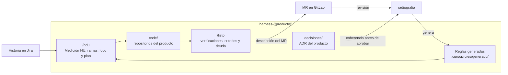

# harness-{{producto}}

Repositorio de trabajo para desarrollar **{{producto}}** con [Cursor](https://cursor.com). Reúne los
repositorios del producto en `code/` y las reglas que el código debe cumplir, para que cada historia de
Jira se desarrolle con el mismo contexto y llegue al MR ya verificada.

Lo gobierna **radiografia**, la herramienta que revisa los productos: genera las reglas de este
repositorio, verifica la coherencia de sus decisiones y revisa sus MR.

## Conceptos en una línea

| Término | Qué es |
|---|---|
| **HU** | Historia de usuario: una tarea de Jira con lo que hay que construir y sus criterios de aceptación |
| **Medición HU** | Campo de Jira con la calidad de la historia. Solo se toman historias **Óptimas, Completas o Adecuadas**; si está vacía se toma, pero hay que registrar la deuda que deja |
| **Criterio de aceptación** | Cada condición que la historia debe cumplir; cada uno necesita una prueba |
| **ADR** | Registro de una decisión de arquitectura: qué se decidió, por qué y qué regla deja. Los de este producto viven en `decisiones/` |
| **Reglas generadas** | Las decisiones de arquitectura, del equipo y del producto, compiladas por radiografia en `.cursor/rules/generado/`. Cursor las aplica solas |
| **Hallazgo** | Un incumplimiento ya detectado en el código, con archivo y línea. Si se toca ese código, se corrige en el mismo trabajo |
| **Deuda** | Lo que la historia deja pendiente a sabiendas (técnica: código; operativa: trabajo manual). Se declara en el MR y radiografia la lleva a Jira |
| **MR** | Merge request: la propuesta de cambio que se revisa antes de integrarla |
| **Spike** | Historia de investigación, de 2 días como máximo, que termina con un ADR del producto en `Propuesto` |
| **Foco** | Dejar visibles en Cursor solo los repositorios de la historia, para que no busque en los demás |

## Cómo se trabaja



1. **`/hdu <CLAVE>`** toma la historia (por ejemplo `/hdu FRAUD-123`). Lee Jira, comprueba la Medición
   HU, crea la rama `feature/<CLAVE>-…` en cada repositorio que toca, deja visibles en Cursor solo esos
   repositorios y arma el contexto: criterios, hallazgos abiertos, componentes y terceros. Después
   propone un plan con una prueba por criterio y espera el OK antes de implementar.
2. **Desarrollar** en `code/<repo>/`, en la rama de la historia, con el flujo normal de git y los
   commits de siempre. Cursor aplica las reglas generadas mientras se trabaja.
3. **`/listo <CLAVE>`** antes del MR. Verifica el cambio (secretos, salida a consola, `TODO`, contratos,
   integraciones, pruebas debilitadas), contrasta el diff con las reglas, registra la prueba de cada
   criterio y la deuda que deja la historia, y escribe la descripción del MR en
   `trabajo/<CLAVE>/mr-<repo>.md`.
4. **Push y MR** con esa descripción. El registro que va al final de la descripción lo usa la revisión de
   radiografia: no se edita.

## Empezar

Requisitos: Python 3.11, `git`, `make` y Cursor; `gitleaks` para buscar secretos (`brew install
gitleaks`); acceso de lectura por git a los repositorios del producto; un token de Jira con lectura del
proyecto.

```sh
cp .env.example .env    # JIRA_URL, JIRA_EMAIL y JIRA_TOKEN, para que /hdu lea las historias
make doctor             # verifica git, Python 3.11, gitleaks y que code/ quede fuera de git
make code               # clona los repositorios del producto en code/; ENLAZAR=~/repos reutiliza clones existentes
```

Abrir esta carpeta en Cursor (la carpeta del harness, no la de un repositorio). Cursor lee `AGENTS.md`,
las decisiones de `.cursor/rules/generado/decisiones.mdc` y, al trabajar en `code/<repo>/`, el contexto
de ese repositorio.

## Comandos

| En Cursor | Cuándo | Qué hace |
|---|---|---|
| `/hdu <CLAVE>` | al empezar una historia | Medición HU, ramas, foco, contexto y plan con una prueba por criterio |
| `/listo <CLAVE>` | antes de abrir el MR | verificaciones, prueba de cada criterio, deuda que deja y descripción del MR |

| En la terminal | Cuándo | Qué hace |
|---|---|---|
| `make code [ENLAZAR=<carpeta>]` | la primera vez y cuando hay repositorios nuevos | clona o actualiza los repositorios en `code/`, sin cambiar las ramas de trabajo |
| `make actualizar` | al empezar el día | trae la última versión de este harness y las novedades de los repositorios |
| `make foco [REPOS=a,b]` | si hace falta cambiar los repositorios visibles | sin `REPOS`, vuelve a mostrar todos |
| `make doctor` | si algo falla | verifica las herramientas |

## Estructura

```
AGENTS.md · README.md · Makefile · .env.example
repos.json · config.json · contexto.json · lenguaje.json · GENERADO.json    generados por radiografia
.cursor/rules/generado/      decisiones y contexto de cada repositorio (generados; no se editan)
.cursor/commands/            /hdu y /listo
.cursor/hooks.json           guardia de comandos
decisiones/                  ADR del producto, plantilla, INDICE.md y COHERENCIA.md
herramientas/                harness.py, hdu.py, listo.py y guardia.py
code/                        repositorios del producto (fuera de git de este repositorio)
trabajo/<CLAVE>/             contexto, verificaciones y descripción del MR de cada historia (local)
```

## Qué viene de radiografia

Lo generado (`.cursor/rules/generado/`, los archivos `.json` de la raíz y los índices de `decisiones/`)
no se edita a mano: los cambios llegan con `make actualizar`. El resto (este README, `AGENTS.md`, el
Makefile, `herramientas/` y la guardia) se mantiene por MR a este repositorio. Cuando radiografia agrega
algo nuevo a la plantilla, aparece solo; nunca pisa lo que ya se ajustó aquí.

## Guardia

Los comandos de terminal que ejecuta Cursor pasan por `.cursor/hooks.json`: se bloquean el push a `main`
o `master`, el push con `--force`, aprobar o mergear MR con `glab` o `gh` y las escrituras HTTP directas.
El resto del flujo de git funciona normalmente.

## Decisiones del producto

Viven en `decisiones/` (`ADR-{{sigla}}-NNN`). Nacen en `Propuesto` por MR a este repositorio, por ejemplo
como entregable de un Spike: `python3 herramientas/harness.py adr --titulo "<decisión>" --historia <CLAVE>`.
Antes de aprobarlas, radiografia verifica su coherencia con arquitectura y con las decisiones del equipo.
Ver [decisiones/README.md](decisiones/README.md).
